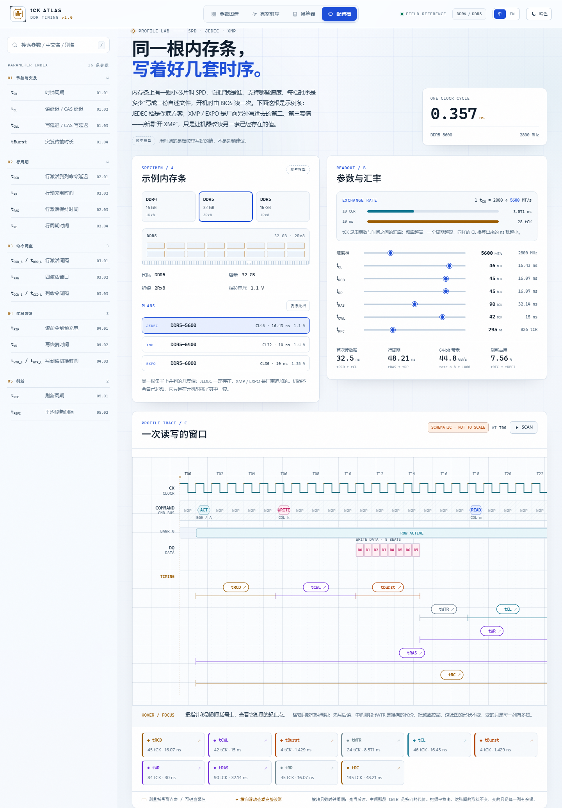
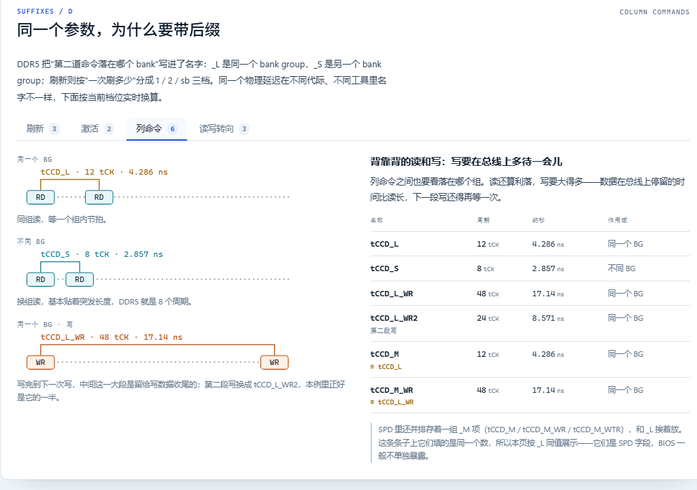

# tCK Atlas

**Live:** https://qmjianda.github.io/tck-atlas/

**DDR timing, mapped.** An offline DDR4 / DDR5 timing-parameter atlas that explains where each parameter starts, where it ends, and how it relates to its neighbours — through waveforms, measurement brackets and readout cards. Ships in Chinese and English, in light and dark themes.

**DDR 时序参数图谱。** 一个离线可用的 DDR4 / DDR5 时序参数百科，用波形、测量括号和读数卡解释参数从哪里起算、到哪里结束，以及它和相邻时序之间的关系。提供中文 / 英文两种界面，以及亮色 / 暗色两套主题。

- [English](#english)
- [中文](#中文)


---

## English

- 16 common DDR4 / DDR5 timing parameters
- 3 views: the parameter atlas, a full read-write sequence, and a cycle calculator
- A profile lab: one sample module, several timing plans, and a waveform that rebuilds from them
- Suffixed timing families (`tRFC1/2/sb`, `tRRD_L/S`, `tCCD_L/S/WR`, `tWTR_L/S`) compared scope by scope
- Chinese / English interface with a header switch, remembered across visits
- Light / dark themes that follow the system and remember your choice
- Plain HTML / CSS / JavaScript: no build step, no dependencies, no network requests
- Works on desktop, tablet and phone

### Opening it

The site is deployed on GitHub Pages: **https://qmjianda.github.io/tck-atlas/**. To run it locally, double-click `index.html` — the page uses local scripts and hash routing, so it runs fully from `file://`.

You can also serve the folder statically:

```powershell
python -m http.server 8080
```

then open `http://localhost:8080`.

### Language and theme

The header holds two switches. The `中 / EN` group changes every piece of interface copy — chrome, waveform annotations, parameter copy and calculator readouts — and stores the choice in `localStorage` (`tck-atlas-lang`). First visit follows `navigator.language`. The theme button switches between light and dark, follows `prefers-color-scheme` on first visit, and remembers manual choices in `tck-atlas-theme`.


Both themes share one layout and one set of waveform semantics; only colours, contrast and surface layers change.

### The four views

**Atlas.** The sidebar lists all parameters grouped as clock & burst / row cycle / scheduling / turnaround / refresh, and searches symbols, Chinese names, English names and aliases.

Each parameter page contains an engineering definition and "how to read", an interactive SVG waveform (measurement brackets, bank state, data bursts, scan playback), a spec sheet, the governing relation, the most common mistake, a memory hook, neighbouring parameters, and paired variants such as `tRRD_S / tRRD_L` or `tWTR_S / tWTR_L`.

**Sequence.** One access, both directions — `ACT → WRITE → write data → turnaround → READ → read data → PRE → next ACT` — on a single time axis, overlaying `tRCD`, `tCWL`, `tWTR`, `tCL`, `tWR`, `tRAS`, `tRP` and `tRC` across five measurement rows. Clicking a bracket or a footer note jumps to the matching parameter page. The axis is wider than the panel, so it scrolls sideways; the `SCAN` playback walks the viewport along with the playhead.


**Calculator.** Enter data rate, CL / CWL, burst length, tRCD / tRP / tRAS and tRFC / tREFI to get, live: one clock cycle `tCK`, read / write latency, time to first data beat, the burst window, the row cycle, theoretical single-channel bandwidth, average refresh overhead, and two-way cycle ↔ nanosecond conversion.


Presets only change the data rate; fill the cycle parameters from your device's datasheet. Bandwidth here is a single-channel theoretical figure and excludes ranks, channels, protocol efficiency and controller overhead.

**Profile Lab.** A teaching sandbox for the idea behind SPD: one module carries several complete timing plans — the JEDEC floor plus whatever the vendor added (XMP / EXPO). Pick a sample module, switch plans, and the readout column and the waveform rebuild from that one plan: cycle counts on the left, absolute nanoseconds on the right, an exchange-rate ruler for `tCK`, and the same `ACT → WRITE → turnaround → READ → PRE` window as the sequence view, recomputed from the plan you picked. Dragging a slider is an experiment, not overclocking advice — the diagram keeps its shape because only the clock gets shorter.



Nothing here reads a real SPD file, and no number belongs to a specific part. The module, the plans and the timings are a normalised teaching model; a real decoder could replace the producer without touching any of the views.

**Suffixed timings.** A real decoder prints a lot of names that look like duplicates: `tRFC1 / tRFC2 / tRFCsb`, `tRRD_L / tRRD_S`, `tCCD_L / tCCD_S / tCCD_L_WR / tCCD_L_WR2`, `tWTR_L / tWTR_S`. The suffix is the *scope*, not a second parameter: `_L` means the second command lands in the same bank group, `_S` means a different one, and refresh splits by how much gets refreshed in a single command. The panel draws each family on one shared ruler — two commands, the bracket between them, the gap in cycles and in nanoseconds — and recomputes every member when you move the speed slider. Where DDR5 renamed a symbol (`tWTR_L` → `tCCD_L_WTR`) both names are printed side by side. The `_M` fields that sit next to the `_L` ones in the SPD image are shown as the copies they are on this module, not as a third mechanism.




### Interaction cheat sheet

| Action | Result |
| --- | --- |
| `中 / EN` in the header | Switch interface language; the choice is remembered |
| Theme button in the header | Switch light / dark; the choice is remembered |
| Click a measurement bracket | Open that parameter page |
| Hover / Tab onto a bracket | Read its start and end points below the waveform |
| `SCAN` | Play the time-axis scan |
| `VARIANT` tabs | Switch paired views such as `_S` / `_L` |
| `/` | Focus the sidebar search |
| `Esc` | Clear the search or close the mobile index |
| Mobile menu | Open the parameter index; tap the scrim or close button to dismiss |
| Swipe the waveform | See the full cycles and brackets when it overflows |
| Drag a slider in Profile Lab | Re-derive nanoseconds and rebuild the waveform |

### Scope

This is a teaching and design-discussion aid, not the JEDEC standard and not any particular device's timing table.

- Cycle counts in the waveforms explain ordering; the time axis is not necessarily to scale.
- `tCK(ns) = 2000 / data rate (MT/s)`; `tCL(ns) = CL × tCK`; `tBurst = BL / 2 × tCK`.
- Average refresh overhead is estimated as `tRFC / tREFI`; DDR5 refresh modes, all-bank / per-bank refresh and temperature zones are more involved.
- A real design sign-off must go back to JEDEC, the device datasheet and the controller / PHY manuals.

### Layout

```text
tck-atlas/
├─ index.html   # page shell, icon sprite, four view containers, theme/language preload
├─ i18n.js      # UI dictionary (zh/en) and English overlays for every parameter
├─ data.js      # 16 parameters, categories, sequence, calculator presets
├─ lab.js       # profile lab model: sample modules, plans, derived values, trace geometry
├─ app.js       # routing, parameter pages, SVG waveforms, calculator, profile lab, theme/language switching
├─ styles.css   # base layout, waveform and component structure
├─ theme.css    # light/dark tokens, typography and visual overrides
├─ lab.css      # profile lab layout: specimen card, sliders, exchange-rate ruler
├─ tools/
│  └─ i18n-audit.mjs   # node tools/i18n-audit.mjs — checks dictionary coverage
├─ docs/        # README screenshots
└─ README.md
```

No npm dependencies and no build output. GitHub Pages serves the repository root directly, so pushing to `main` updates the live site.

### Adding a parameter

Add an object to `window.DDR_ATLAS.params` in `data.js` and give it an existing `category`; the page appears in the sidebar, search and routing automatically. Field reference:

```js
{
  id: 'txxx',
  category: 'clock',          // clock | row | schedule | recovery | refresh
  symbol: 'tXXX',
  nameZh: '中文名',
  nameEn: 'English Name',
  aliases: ['alias'],
  intro: 'An engineering-facing definition.',
  tags: ['TAG A', 'TAG B'],
  facts: [{ label: 'Dimension', value: 'tCK (cycles)' }],
  relation: 'A → B = tA + tB',
  relationNote: 'Boundary conditions or common misreadings.',
  steps: [
    { tag: '01', title: 'Step one', text: '...' },
    { tag: '02', title: 'Step two', text: '...' },
    { tag: '03', title: 'Step three', text: '...' }
  ],
  context: 'What it changes inside the controller / PHY.',
  pitfall: 'The easiest thing to get wrong.',
  memory: 'A one-line memory hook.',
  flow: [{ label: 'ACT', sub: 'activate' }, { label: 'tXXX', sub: 'wait', key: true }],
  related: ['trcd', 'tras'],
  traceTitle: 'Waveform title',
  trace: {
    cycles: 12,
    commands: [
      { at: 1, label: 'ACT', kind: 'act', sub: 'BANK 0' },
      { at: 5, label: 'READ', kind: 'read', sub: 'COL n' }
    ],
    auxLanes: [
      { label: 'BANK 0', segments: [{ from: 1, to: 12, label: 'ROW ACTIVE', kind: 'active' }] }
    ],
    dataBursts: [{ from: 9, to: 13, cells: ['DQ 00', 'DQ 01'], kind: 'read' }],
    spans: [
      {
        from: 1,
        to: 5,
        label: 'tXXX',
        kind: 'primary',
        caption: 'start and end',
        desc: 'What this window constrains.',
        target: 'txxx',
        row: 0
      }
    ],
    caption: 'Example values, not tied to a specific speed bin.'
  }
}
```

`commands[].kind` accepts `act`, `read`, `write`, `pre`, `ref`; `spans[].kind` accepts display tones such as `primary`, `amber`, `cyan`, `orange`, `violet`, `muted`. When `spans[].target` names another parameter `id`, clicking the bracket navigates there. Paired parameters can add a `variants` array of `{ label, trace }`; the tabs reuse the same waveform panel and interactions.

Then add the English copy for the new parameter to the `params` overlay in `i18n.js` (same fields, English text) and run `node tools/i18n-audit.mjs`; it reports any Chinese copy still reachable in the English interface.

### How the theme and language work

- `theme.css` defines two sets of colour tokens with `:root` and `html[data-theme="dark"]`, so layout is never duplicated.
- A tiny inline script in `index.html` runs before the stylesheets: it reads `tck-atlas-theme` (and the legacy `ddr-atlas-theme`) or the system preference, applies `data-theme` early to avoid a first-paint flash, and resolves the interface language (`tck-atlas-lang`, else `navigator.language`) into `window.__TCK_LANG` plus `html[data-lang]`.
- `i18n.js` holds the `ui` dictionary keyed by dotted ids, plus a per-parameter English overlay. `app.js` renders chrome text through `uiText(key)`, applies `data-i18n*` attributes on load and on switch, and routes parameter copy through `localizeParam` / `localizeTrace`.
- Both the theme and language buttons expose `aria-label`, `title` and `aria-pressed`; the top bar, sidebar and mobile index stay keyboard-reachable.

### Browsers

Modern browsers: `color-mix()`, `prefers-color-scheme`, `100dvh`, SVG patterns and `ResizeObserver`. Recent Edge / Chrome / Firefox / Safari. No IE support.

---

## 中文

- 16 个 DDR4 / DDR5 常用时序参数
- 3 个视图：参数图谱、完整读取时序、周期换算器
- 配置档实验室：一根示例内存条、几套档位，以及由这些值重建的波形
- 带后缀的时序族（`tRFC1/2/sb`、`tRRD_L/S`、`tCCD_L/S/WR`、`tWTR_L/S`）按作用域对照讲解
- 中文 / 英文双语界面，顶栏切换，选择会被记住
- 亮色 / 暗色双主题，跟随系统并记住手动选择
- 纯 HTML / CSS / JavaScript，无构建步骤、无外部依赖、无网络请求
- 桌面、平板、手机均可使用

### 打开方式

在线版本已部署在 GitHub Pages：**https://qmjianda.github.io/tck-atlas/**。

也可以直接双击 `index.html` 本地运行。页面使用本地脚本和 hash 路由，`file://` 环境下可以完整运行。

也可以在当前目录启动一个静态服务器：

```powershell
python -m http.server 8080
```

然后访问 `http://localhost:8080`。

### 界面语言与主题

顶栏有两组开关。`中 / EN` 切换全部界面文案——框架、波形标注、参数正文和换算器读数——并写入 `localStorage`（`tck-atlas-lang`）；首次打开跟随 `navigator.language`。主题按钮在亮色和暗色之间切换，首次打开跟随系统 `prefers-color-scheme`，手动选择写入 `tck-atlas-theme`。


两套主题使用同一套布局和时序图，只切换颜色、对比度和表面层级；波形中的测量颜色、命令类型和数据方向保持一致的语义。

### 四个视图

**参数图谱。** 左侧按「时钟与突发 / 行周期 / 命令调度 / 读写恢复 / 刷新」分组列出全部参数，支持搜索符号、中文名、英文名和别名。

每个参数页包含：一段工程语境下的定义和「怎么读」；可交互的 SVG 时序图（测量括号、Bank 状态、数据突发、扫描播放）；参数读数卡、关系式、易错点、记忆钩子；相邻参数入口；以及同一页面内的配对变体，例如 `tRRD_S / tRRD_L`、`tWTR_S / tWTR_L`。

**完整时序。** 一次访问的两个方向放在同一根时间轴上：`ACT → WRITE → 写数据 → 换向 → READ → 读数据 → PRE → 下一次 ACT`，五行测量括号叠加 `tRCD`、`tCWL`、`tWTR`、`tCL`、`tWR`、`tRAS`、`tRP`、`tRC`。点击任意测量括号或页脚说明，会直接跳到对应参数页。时间轴比面板宽，因此可以横向滚动；`SCAN` 播放时视口会跟着游标走。


**换算器。** 输入数据率、CL / CWL、突发长度、tRCD / tRP / tRAS、tRFC / tREFI，实时得到：一个时钟周期 `tCK`；读延迟、写延迟、首拍数据时间；数据突发窗口；行周期；理论单通道带宽；刷新平均占用；周期 ↔ 纳秒双向换算。


速度档位切换只改变数据率；其余周期参数请按当前器件的手册填。这里的带宽是单通道理论值，不包含 rank、通道数、协议效率或控制器开销。

**配置档实验室。** SPD 的教学沙盘：一根内存条上写着好几套完整时序——JEDEC 保底，加上厂商追加的 XMP / EXPO。选一根示例条、切换档位，读数区和波形都从同一套值重建：左边是周期数，右边是纳秒，中间一条 `tCK` 汇率尺，下面还是 `ACT → WRITE → 换向 → READ → PRE` 那个窗口，只是换成你选中的那套值。拖动滑杆是实验，不是超频建议——图的形状不变，变的只是每个时钟更短。


这一页不解析真实 SPD 文件，也没有任何一个数字属于具体型号：内存条、档位和时序都是归一化后的教学模型。将来换成真正的解码器时，只需要替换数据的生产者，视图本身不用改。

**带后缀的时序。** SPD 读取器会打印一堆看起来重复的名字：`tRFC1 / tRFC2 / tRFCsb`、`tRRD_L / tRRD_S`、`tCCD_L / tCCD_S / tCCD_L_WR / tCCD_L_WR2`、`tWTR_L / tWTR_S`。后缀说的是**作用域**，不是另一个参数：`_L` 表示第二道命令落在同一个 bank group，`_S` 表示落在别的 bank group；刷新则按"一个命令刷多少"分成三档。面板把同一族放在一把尺子上：两道命令、中间的括号、以周期和纳秒同时给出的间距，拖动速度滑杆时整族一起重算。DDR5 改过名的地方（`tWTR_L` → `tCCD_L_WTR`）两个名字并排写。至于 SPD 里和 `_L` 挨着的那组 `_M` 字段，这里按"这条条子上它们就是同一份数值"来展示，不替它编第三种机制。


### 交互速查

| 操作 | 结果 |
| --- | --- |
| 顶栏 `中 / EN` | 切换界面语言，选择会记住 |
| 右上角主题按钮 | 在亮色 / 暗色主题间切换，选择会记住 |
| 点击测量括号 | 打开该时序参数页 |
| 悬停 / Tab 聚焦测量括号 | 在波形下方查看起止点说明 |
| `SCAN` | 播放时间轴扫描 |
| `VARIANT` 标签 | 切换 `_S` / `_L` 等配对视图 |
| `/` | 聚焦左侧参数搜索 |
| `Esc` | 清空搜索或关闭移动端目录 |
| 移动端菜单 | 打开参数目录，点遮罩或关闭按钮收起 |
| 波形过宽时左右滑动 | 查看完整周期和测量括号 |
| 在配置档里拖动滑杆 | 重算纳秒读数并重建波形 |

### 工程口径

本项目是教学和设计讨论用的示意图，不是 JEDEC 标准文本，也不是某个具体颗粒的时序表。

- 波形中的周期数用于说明参数之间的先后关系，时间轴不一定等比例。
- `tCK(ns) = 2000 / 数据率(MT/s)`；`tCL(ns) = CL × tCK`；`tBurst = BL / 2 × tCK`。
- 刷新平均占用按 `tRFC / tREFI` 估算；DDR5 的刷新模式、同 Bank / 全 Bank 刷新与温度分区会更复杂。
- 真实设计签署必须回到 JEDEC 标准、具体器件 datasheet 和控制器 / PHY 手册。

### 目录结构

```text
tck-atlas/
├─ index.html   # 页面骨架、图标、四个视图容器、主题与语言预加载
├─ i18n.js      # 中英文界面词典，以及全部参数的英文覆盖
├─ data.js      # 16 个参数、分类、完整时序、换算器档位
├─ lab.js       # 配置档模型：示例内存条、档位、派生读数与波形几何
├─ app.js       # 路由、参数页、SVG 波形渲染、换算器、配置档、主题与语言切换
├─ styles.css   # 基础布局、波形与组件结构
├─ theme.css    # 亮 / 暗主题令牌、排版和视觉覆盖
├─ lab.css      # 配置档布局：内存条卡片、滑杆、汇率尺
├─ tools/
│  └─ i18n-audit.mjs   # node tools/i18n-audit.mjs，检查词典覆盖
├─ docs/        # README 预览图
└─ README.md
```

没有 npm 依赖，也没有构建产物。GitHub Pages 直接托管仓库根目录，推送到 `main` 即更新线上站点。

### 扩展一个新参数

在 `data.js` 的 `window.DDR_ATLAS.params` 中增加一个对象，并把它挂到对应 `category`。参数页会自动出现在左侧目录、搜索和路由中。最小字段参考与英文版示例相同（`id / category / symbol / nameZh / nameEn / aliases / intro / tags / facts / relation / relationNote / steps / context / pitfall / memory / flow / related / traceTitle / trace`）。

`commands[].kind` 支持 `act`、`read`、`write`、`pre`、`ref`；`spans[].kind` 支持 `primary`、`amber`、`cyan`、`orange`、`violet`、`muted` 等显示色调。`spans[].target` 指向另一个参数 `id` 时，点击括号可直接跳转。配对参数可增加 `variants` 数组，结构为 `{ label, trace }`，切换标签会复用同一个波形面板和交互逻辑。

随后在 `i18n.js` 的 `params` 覆盖中补上该参数的英文字段，并运行 `node tools/i18n-audit.mjs`；它会把英文界面中仍会露出中文的位置列出来。

### 主题与语言实现

- `theme.css` 用 `:root` 和 `html[data-theme="dark"]` 分别定义两套颜色令牌，避免复制整套布局。
- `index.html` 在样式表之前执行一小段内联脚本：读取 `tck-atlas-theme`（兼容旧的 `ddr-atlas-theme`）或系统偏好，先设置 `data-theme`，减少首屏闪烁；同时把界面语言（`tck-atlas-lang`，否则 `navigator.language`）解析进 `window.__TCK_LANG` 和 `html[data-lang]`。
- `i18n.js` 保存以点号键名索引的 `ui` 词典，以及每个参数的英文覆盖层；`app.js` 通过 `uiText(key)` 渲染框架文案，加载时和切换时应用 `data-i18n*` 属性，参数正文统一走 `localizeParam` / `localizeTrace`。
- 主题按钮和语言按钮都带 `aria-label`、`title` 和 `aria-pressed`；顶栏、侧栏和移动端目录保持键盘可达。

### 浏览器

面向现代浏览器。使用了 CSS `color-mix()`、`prefers-color-scheme`、`100dvh`、SVG pattern 和 `ResizeObserver`；Edge / Chrome / Firefox / Safari 的较新版本均可。没有为 IE 做兼容。
