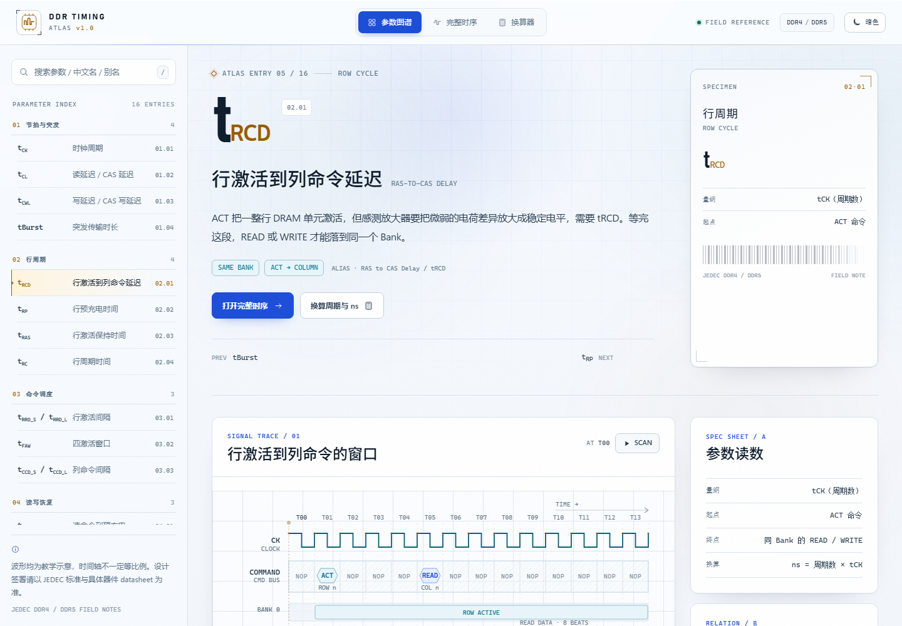
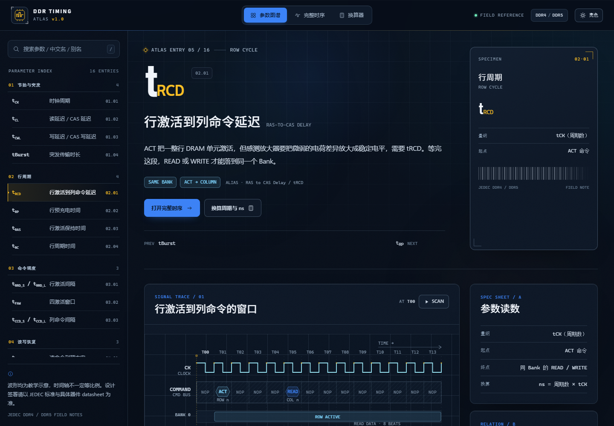
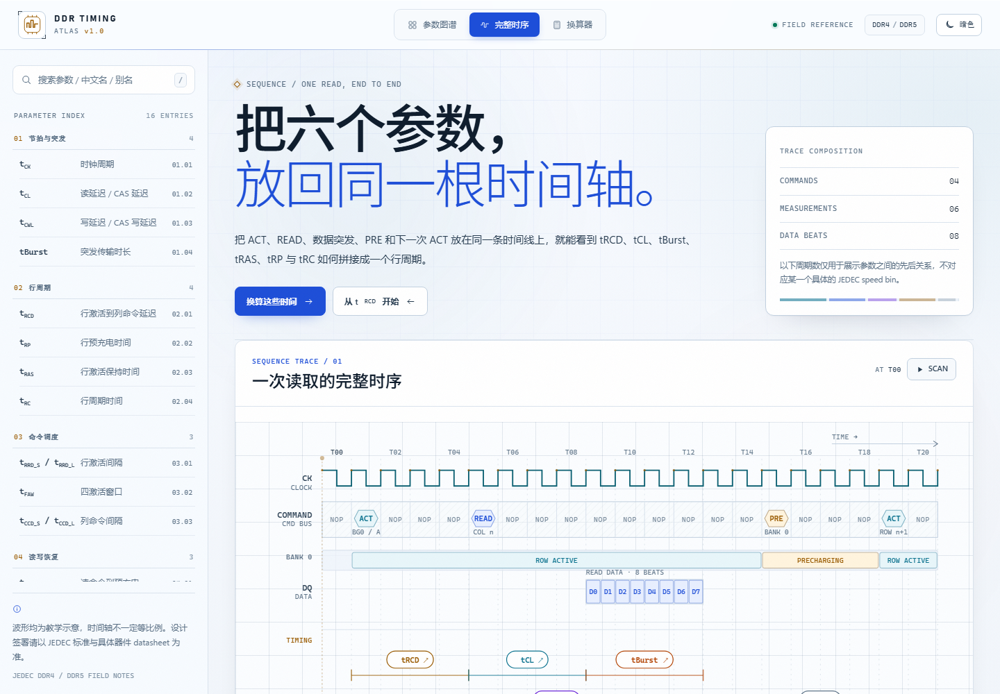
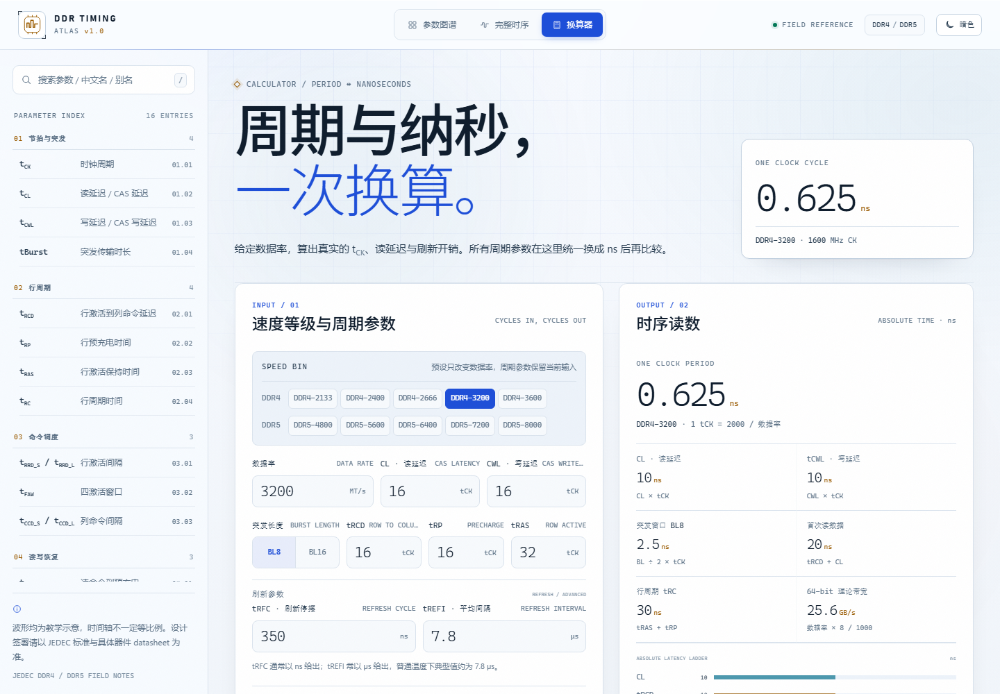

# DDR Timing Atlas

一个离线可用的 DDR 时序参数百科。用波形、测量括号和读数卡解释参数从哪里起算、到哪里结束，以及它和相邻时序之间的关系。界面提供亮色 / 暗色两套主题，正文、波形标注和换算器读数都按可读尺寸重新排版。



- 16 个 DDR4 / DDR5 常用时序参数
- 3 个视图：参数图谱、完整读取时序、周期换算器
- 亮色 / 暗色双主题，跟随系统并记住手动选择
- 纯 HTML / CSS / JavaScript，无构建步骤、无外部依赖、无网络请求
- 桌面、平板、手机均可使用

## 打开方式

直接双击 `index.html` 即可。页面使用本地脚本和 hash 路由，`file://` 环境下可以完整运行。

也可以在当前目录启动一个静态服务器：

```powershell
python -m http.server 8080
```

然后访问 `http://localhost:8080`。

## 亮色 / 暗色主题

右上角的主题按钮可以在亮色和暗色之间切换，图标和文字会提示将要切换到的主题。首次打开时跟随系统的 `prefers-color-scheme`，手动选择会写入 `localStorage`，刷新或下次打开仍然沿用。



两套主题使用同一套布局和时序图，只切换颜色、对比度和表面层级；波形中的测量颜色、命令类型和数据方向保持一致的语义。

## 三个视图

### 参数图谱

左侧按「时钟与突发 / 行周期 / 命令调度 / 读写恢复 / 刷新」分组列出全部参数，支持搜索符号、中文名、英文名和别名。

每个参数页包含：

- 一段工程语境下的定义和「怎么读」
- 可交互的 SVG 时序图：测量括号、Bank 状态、数据突发、扫描播放
- 参数读数卡、关系式、易错点、记忆钩子
- 相邻参数入口
- 同一个页面内的配对变体，例如 `tRRD_S / tRRD_L`、`tWTR_S / tWTR_L`

### 完整时序

把一次读访问的 `ACT → READ → BL8 数据 → PRE → 下一次 ACT` 放在同一根时间轴上，并叠加 `tRCD`、`tCL`、`tBurst`、`tRAS`、`tRP`、`tRC`。



点击任意测量括号或页脚说明，会直接跳到对应参数页。

### 换算器

输入数据率、CL / CWL、突发长度、tRCD / tRP / tRAS、tRFC / tREFI，实时得到：

- 一个时钟周期 `tCK`
- 读延迟、写延迟、首拍数据时间
- 数据突发窗口
- 行周期
- 理论单通道带宽
- 刷新平均占用
- 周期 ↔ 纳秒双向换算



速度档位切换只改变数据率；其余周期参数请按当前器件的手册填。这里的带宽是单通道理论值，不包含 rank、通道数、协议效率或控制器开销。

## 交互速查

| 操作 | 结果 |
| --- | --- |
| 右上角主题按钮 | 在亮色 / 暗色主题间切换，选择会记住 |
| 点击测量括号 | 打开该时序参数页 |
| 悬停 / Tab 聚焦测量括号 | 在波形下方查看起止点说明 |
| `SCAN` | 播放时间轴扫描 |
| `VARIANT` 标签 | 切换 `_S` / `_L` 等配对视图 |
| `/` | 聚焦左侧参数搜索 |
| `Esc` | 清空搜索或关闭移动端目录 |
| 移动端菜单 | 打开参数目录，点遮罩或关闭按钮收起 |
| 波形过宽时左右滑动 | 查看完整周期和测量括号 |

## 工程口径

本项目是教学和设计讨论用的示意图，不是 JEDEC 标准文本，也不是某个具体颗粒的时序表。

- 波形中的周期数用于说明参数之间的先后关系，时间轴不一定等比例。
- `tCK(ns) = 2000 / 数据率(MT/s)`；`tCL(ns) = CL × tCK`；`tBurst = BL / 2 × tCK`。
- 刷新平均占用按 `tRFC / tREFI` 估算；DDR5 的刷新模式、同 Bank / 全 Bank 刷新与温度分区会更复杂。
- 真实设计签署必须回到 JEDEC 标准、具体器件 datasheet 和控制器 / PHY 手册。

## 目录结构

```text
ddr-timing/
├─ index.html   # 页面骨架、图标、三个视图容器、主题预加载
├─ data.js      # 16 个参数、分类、完整时序、换算器档位
├─ app.js       # 路由、参数页、SVG 波形渲染、换算器、主题切换
├─ styles.css   # 基础布局、波形与组件结构
├─ theme.css    # 亮 / 暗主题令牌、排版和视觉覆盖
├─ docs/        # README 预览图
└─ README.md
```

没有 npm 依赖，也没有构建产物。

## 扩展一个新参数

在 `data.js` 的 `window.DDR_ATLAS.params` 中增加一个对象，并把它挂到对应 `category`。参数页会自动出现在左侧目录、搜索和路由中。

最小字段参考：

```js
{
  id: 'txxx',
  category: 'clock',          // clock | row | schedule | recovery | refresh
  symbol: 'tXXX',
  nameZh: '中文名',
  nameEn: 'English Name',
  aliases: ['别名'],
  intro: '一段面向工程读者的定义。',
  tags: ['TAG A', 'TAG B'],
  facts: [{ label: '量纲', value: 'tCK（周期数）' }],
  relation: 'A → B = tA + tB',
  relationNote: '关系的边界条件或常见误解。',
  steps: [
    { tag: '01', title: '第一步', text: '...' },
    { tag: '02', title: '第二步', text: '...' },
    { tag: '03', title: '第三步', text: '...' }
  ],
  context: '它在控制器 / PHY 里的实际影响。',
  pitfall: '最容易算错的地方。',
  memory: '一句记忆钩子。',
  flow: [{ label: 'ACT', sub: '开行' }, { label: 'tXXX', sub: '等待', key: true }],
  related: ['trcd', 'tras'],
  traceTitle: '波形标题',
  trace: {
    cycles: 12,
    commands: [
      { at: 1, label: 'ACT', kind: 'act', sub: 'BANK 0' },
      { at: 5, label: 'READ', kind: 'read', sub: 'COL n' }
    ],
    auxLanes: [
      { label: 'BANK 0', segments: [{ from: 1, to: 12, label: 'ROW ACTIVE', kind: 'active' }] }
    ],
    dataBursts: [{ from: 9, to: 13, cells: ['DQ 00', 'DQ 01'], kind: 'read' }],
    spans: [
      {
        from: 1,
        to: 5,
        label: 'tXXX',
        kind: 'primary',
        caption: '起止点',
        desc: '这个窗口在约束什么。',
        target: 'txxx',
        row: 0
      }
    ],
    caption: '示例参数值，不代表具体 speed bin。'
  }
}
```

`commands[].kind` 支持 `act`、`read`、`write`、`pre`、`ref`；`spans[].kind` 支持 `primary`、`amber`、`cyan`、`orange`、`violet`、`muted` 等显示色调。`spans[].target` 指向另一个参数 `id` 时，点击括号可直接跳转。

配对参数可增加 `variants` 数组，结构为 `{ label, trace }`。切换标签会复用同一个波形面板和交互逻辑。

## 主题实现

- `theme.css` 用 `:root` 和 `html[data-theme="dark"]` 分别定义两套颜色令牌，避免复制整套布局。
- `index.html` 在样式表之前执行一小段内联脚本，读取 `ddr-atlas-theme` 或系统偏好，先设置 `data-theme`，减少首屏闪烁。
- `app.js` 只负责切换主题、更新按钮语义和持久化；波形通过 `--wave-*` 等 CSS 变量跟着主题变化。
- 主题按钮带 `aria-label`、`title` 和 `aria-pressed`；顶栏、侧栏和移动端目录保持键盘可达。

## 浏览器

面向现代浏览器。使用了 CSS `color-mix()`、`prefers-color-scheme`、`100dvh`、SVG pattern 和 `ResizeObserver`；Edge / Chrome / Firefox / Safari 的较新版本均可。没有为 IE 做兼容。
